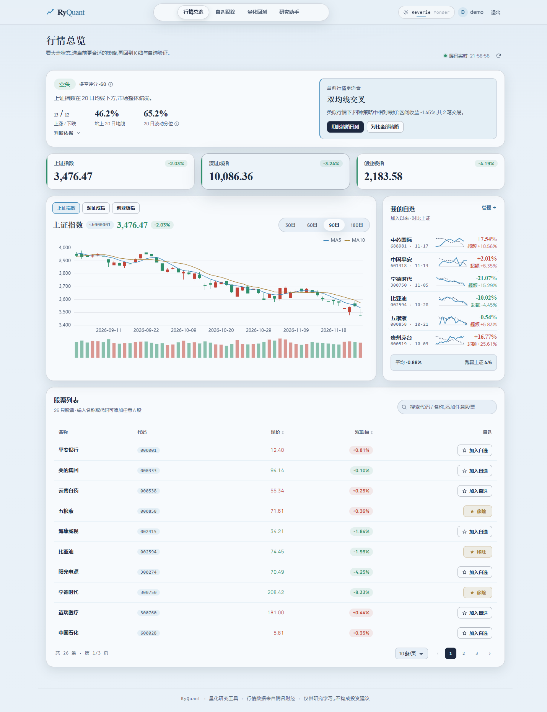
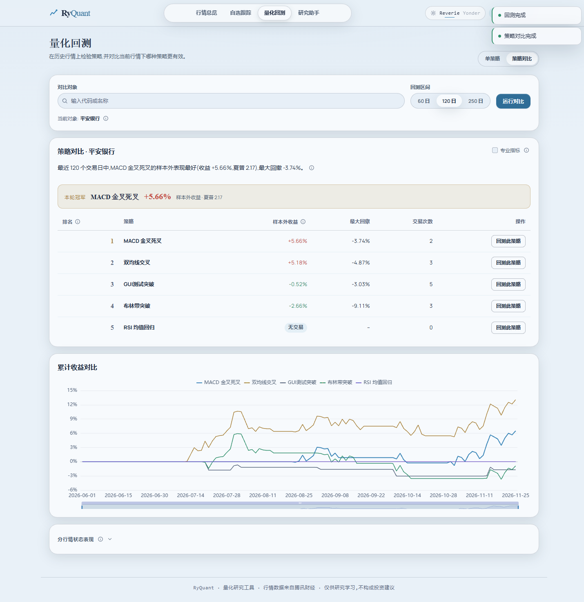
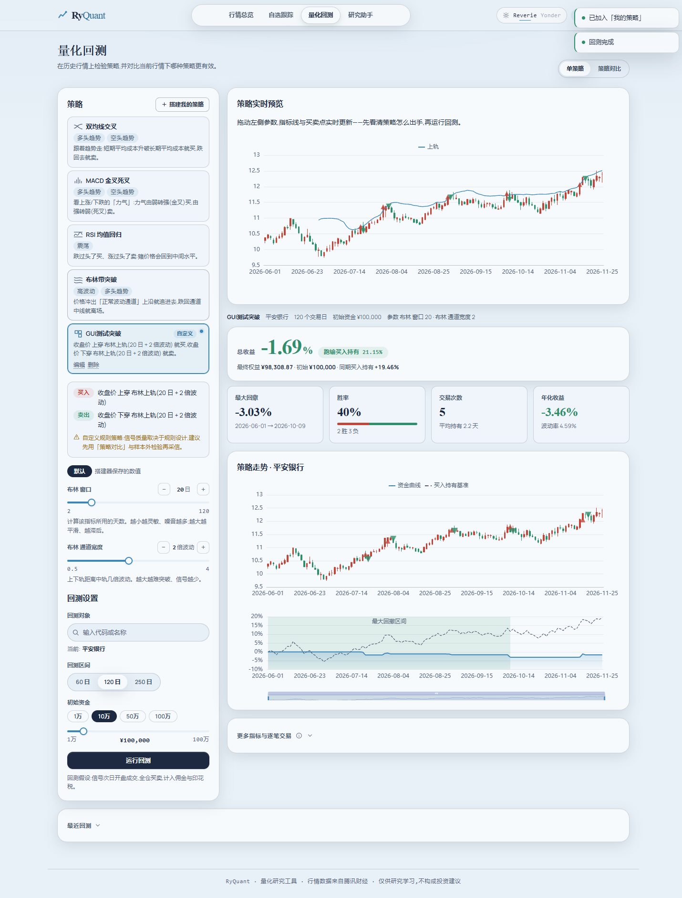
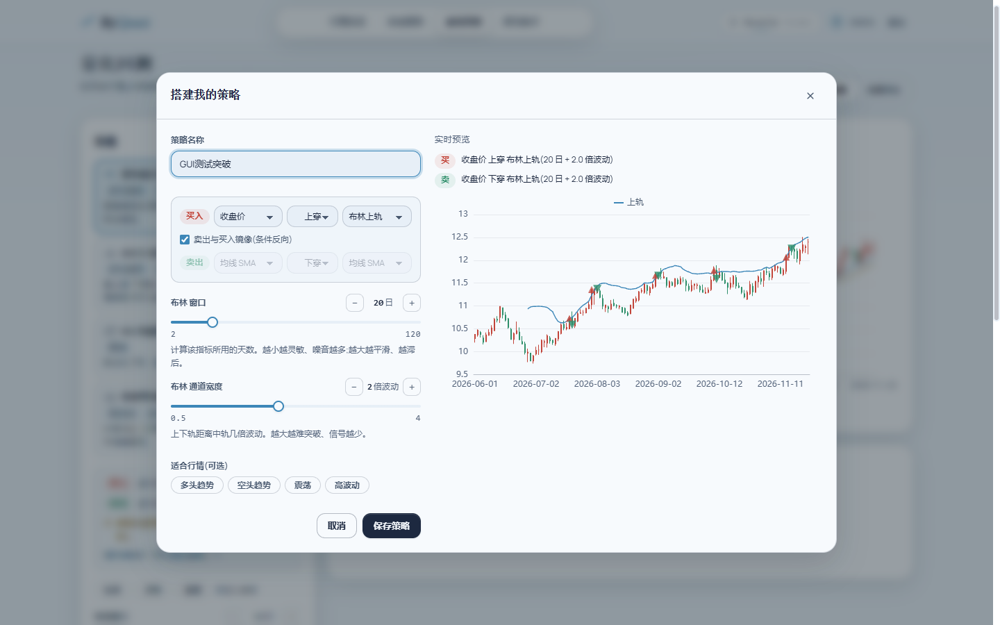
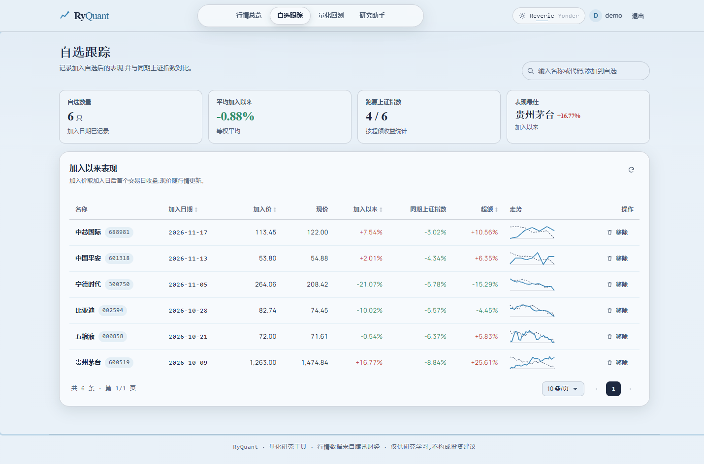

# RyQuant · 量化研究终端


一个轻量、研究导向的**股票量化研究终端**:Django + DRF 后端(真实行情 / 大盘状态推断 / 策略回测与对比 / 标的按需注册)+ Vue 3 克制型研究界面。**不含下单交易功能**——聚焦"看清大盘状态 → 选出当前更有效的策略 → 用自选跟踪验证"。

指数与个股行情、历史日 K 来自真实数据源(失败自动回退模拟并标注来源),离线亦可运行。



## 功能总览

**核心:大盘状态 → 策略有效性**

- 大盘状态 `GET /api/market/pulse/`:涨跌家数 / 站上 MA20 比例 / 均线趋势与斜率 / 20 日波动率分位 → 规则化判定**多头 / 空头 / 震荡 / 高波动**,生成一句白话解读;判断依据(板块、规则信号、完整排名)折叠展示
- **当前行情策略建议**:按当前行情状态的条件化历史表现(有成交才采信)排序,给出 top3;首页直接提供「用此策略回测 / 对比全部策略」入口,形成研究闭环
- 策略对比 `POST /api/backtest/compare/`:四种策略同窗口默认参数 → 全窗口指标 + **滚动 3 折样本外** + **分行情状态评估** + 排名;零交易策略排在真实成交策略之后,避免"0 Sharpe 排第一"
- 单策略回测:次日开盘成交、计入佣金与印花税;指标含 Sharpe / 波动率 / 盈亏比 / Calmar / 在场时间 / 平均持有天数;结果持久化可回看
- **策略实时预览**:右栏 K 线 + 指标叠加线 / 副图(RSI、MACD)+ 买卖信号三角,拖动参数 350ms 内实时重算——先看清策略怎么出手,再运行回测
- **可视化规则搭建器**:不写代码,选「指标 × 条件(上穿/下穿/高于/低于)× 指标/常量」组合买卖规则(支持卖出镜像),边搭边看信号预览,保存为「我的策略」(每用户 10 条)参与回测与对比;内置策略调好参数也可一键存为我的策略
- 策略可理解性:每个策略给白话一句本质 + **买入/卖出规则**(随参数实时替换数值)+ 适合行情标签 + 风险提醒;参数为**步进按钮 + 滑杆 + 三档预设(标准/灵敏/稳健)+ 含义说明**,资金为快捷档 + 滑杆
- 结果英雄区:总收益衬线大数字滚动 + 跑赢/跑输买入持有判定 + 盈亏比例条 + 最大回撤区间在资金曲线上底色标注
- 指数回测按 1 单位粒度(避免整手门槛零成交),个股按真实手数(主板 100 / 科创 200)







**标的注册表:不预置全市场**

- 输入名称或代码 → 腾讯联想 / 本地检索 → 后端识别、落库、按需抓取 250 根真实日 K(失败回退模拟);之后即可加自选、看 K 线、做回测
- 演示池仅 24 只代表性股票(6 板块 × 4 只),用于大盘广度与板块统计;股票库随用户添加增长,不需要本地几千只
- `GET /api/stocks/search/`(公开)与 `POST /api/stocks/resolve/`(登录,限流)

**自选跟踪:让加入日期有意义**

- 加入自选时记录日期与加入价;自选页展示**加入以来收益、同期上证、超额收益、迷你走势**,汇总平均收益与"跑赢上证"数量
- K 线金色虚线标注加入日 + 加入后区间底色;加入日早于默认窗口时自动前移缩放,保证标注可见
- 首页右栏自选速览;任意标的可搜索添加,无需预置



**行情与数据来源**

- 每 tick 一次批量抓取**腾讯实时真实行情**(完整格式,字段自校验防错位),逐标的失败回退随机游走;聚合分钟 / 日 K
- 来源可追溯:`Stock.quote_source` / `Candle.source`;界面只在异常时标「模拟」,正常真实行情不堆徽章
- 历史日 K:`seed_demo` 优先腾讯前复权,失败回退网易,再回退模拟;运行期每交易日后台增量补抓
- 板块行情由成分股真实报价 / 日 K 计算

**界面与交互**

- 研究仪表盘式首页:大盘状态与策略建议 → 指数 → K 线 + 自选侧栏 → 股票列表;无营销 Hero、无跑马灯、无重复面板
- **Reverie(浅)/ Yonder(深)** 双主题(编辑级青绿纸感:衬线展示字 + Manrope 正文 + 等宽小标签、胶囊导航滑动指示器、磨砂铬层);旧 light/dark 偏好自动迁移
- 标的 / 自选 / 逐笔交易 / 回测历史表格均带**分页(10/20/50 可选)、三态排序、数字右对齐等宽、sticky 表头**;移动端自选与策略对比改为卡片式,核心数字不用横向拖动
- 术语分层:默认只给结论与关键指标,样本外 / 夏普 / 盈亏比等收进「专业指标」与 InfoTip
- 研究助手:配置 `DEEPSEEK_API_KEY` 调用真实模型;未配置自动降级离线回答(注入大盘状态与自选上下文),右侧展示当前上下文

## 架构

```
financeapp/
├── backend/                    # Django + DRF
│   ├── manage.py  requirements.txt  .env.example  smoke_test.py
│   ├── finproj/                # 配置(env 驱动)与根路由
│   └── trading/
│       ├── models/             # stock / favorite / market / ai / backtest
│       ├── services/           # market_sim(行情) / market_data(抓取) / market_analysis(状态+建议)
│       │   ├── stock_registry.py   # 名称/代码检索、按需落库、历史补齐
│       │   ├── watchlist.py        # 加入以来收益 / 上证对比
│       │   ├── fees.py             # 回测费率
│       │   └── quant/              # indicators / strategies / engine / compare(对比+advice)
│       │       ├── custom.py       # 规则搭建器:operand 目录 / 校验 / 自动生成策略 spec
│       │       └── preview.py      # 实时预览:指标叠加线 / 副图 / 信号标记
│       ├── api/                # 按域拆分的视图 + 限流 + 统一异常
│       ├── management/commands/  # seed_demo / run_simulator
│       └── tests/              # 104 个后端测试
└── frontend/                   # Vue 3 + Vite + Pinia
    └── src/
        ├── api/  stores/  router/          # 接口层 / 状态 / 路由守卫
        ├── components/                     # MarketStatus / SymbolSearch / KlineChart / Sparkline / WatchlistRail …
        ├── views/                          # 行情总览 / 自选跟踪 / 量化回测(含对比) / 研究助手 / 登录注册
        └── styles/                         # 深浅双主题设计令牌 tokens / base / components
```

## 快速开始

要求:Python ≥ 3.9、Node ≥ 18。

**1. 后端**(默认端口 8000;被占用可换 8080)

```bash
cd backend
pip install -r requirements.txt
python manage.py migrate
python manage.py seed_demo        # 24 只演示股票 + 真实历史 + 演示账户/自选
python manage.py runserver 127.0.0.1:8080
```

**2. 前端**

```bash
cd frontend
npm install
npm run dev                       # http://localhost:5173(默认代理指向 127.0.0.1:8080)
```

> 前端代理目标可用环境变量覆盖:`BACKEND_ORIGIN=http://127.0.0.1:8000 npm run dev`

**3. 体验**

- 演示账号:`demo / demo123456`(6 只自选,加入日期已回填)
- 管理后台:`http://127.0.0.1:8080/admin/`(`admin / admin123456`)
- 核心路径:首页看大盘状态与策略建议 → 「用此策略回测 / 对比全部策略」→ 自选跟踪里看加入以来是否跑赢上证

## 环境变量(`backend/.env`,参考 `.env.example`)

| 变量 | 说明 | 默认 |
|---|---|---|
| `SECRET_KEY` / `DEBUG` / `ALLOWED_HOSTS` | Django 基础配置 | dev 默认 |
| `CORS_ALLOWED_ORIGINS` | 跨域白名单 | localhost:5173 |
| `MARKET_SIMULATION` | 行情模拟器开关 | 1 |
| `SIMULATOR_TICK_SECONDS` | 模拟 tick 间隔(秒) | 3 |
| `DEEPSEEK_API_KEY` | 留空则研究助手走离线回答 | 空 |

## API 一览(前缀 `/api/`,Token 认证)

| 方法 | 路径 | 说明 |
|---|---|---|
| POST | `/register/` `/login/` | 注册 / 登录 → `{token, user}` |
| GET | `/stocks/` `/indices/` `/kline/` `/sectors/` | 行情(公开,含来源标注) |
| GET | `/stocks/search/?q=` | 名称/代码检索(本地 + 腾讯联想,公开) |
| POST | `/stocks/resolve/` | 按需识别并落库、补齐历史(登录,限流 10/min) |
| GET | `/market/pulse/` | 大盘状态 / 广度 / 板块 / 策略建议(公开) |
| GET/POST/DELETE | `/favorites/` `(/<id>/)` | 自选股(含加入日期) |
| GET | `/favorites/summary/` | 加入以来收益 / 同期上证 / 超额(登录) |
| GET | `/strategies/` | 内置 + 本人自定义策略与参数 schema |
| GET/POST | `/strategies/custom/` | 我的策略列表 / 新建(登录,上限 10) |
| PUT/DELETE | `/strategies/custom/<id>/` | 修改 / 删除我的策略(仅本人) |
| POST | `/backtest/` | 运行回测(登录,限流 10/min) |
| POST | `/backtest/preview/` | 策略实时预览(登录,限流 60/min,不持久化) |
| POST | `/backtest/compare/` | 策略对比(登录,限流 10/min,不持久化) |
| GET | `/backtest/history/(/<id>/)` | 回测历史 / 详情 |
| POST | `/ai/query/` | 研究助手问答(登录,限流 10/min) |

## 测试

```bash
# 后端(104 个用例:报价 parser / 来源 / 标的注册表 / 行情推断 / 自选汇总 / 策略对比 / 回测引擎 / 自定义策略)
cd backend && python manage.py test trading

# 前端(格式化 / 日期 / 分页排序 / 参数步进 / 数字滚动,29 个用例)
cd frontend && npm test

# 全链路冒烟(需后端已启动,25 项断言)
cd backend && python smoke_test.py
```

## 生产部署提示

- 设置强 `SECRET_KEY`、`DEBUG=0`、明确的 `ALLOWED_HOSTS` 与 `CORS_ALLOWED_ORIGINS`
- 前端 `npm run build` 后由 Nginx 托管 `dist/`,并将 `/api` 反代到 Django(gunicorn / uwsgi);
  行情模拟器随 runserver 自动启动;生产部署另起常驻进程:`python manage.py run_simulator`
- SQLite 适用于演示;高并发建议切换 PostgreSQL(仅改 `DATABASES`)
- 真实行情依赖腾讯公网接口,若有代理 / 白名单要求请自行调整 `services/market_sim.py` 与 `services/market_data.py`

## 路线图(与轻量目标权衡后留待后续)

- 策略评估进阶:Deflated Sharpe Ratio / PBO(CPCV)/ 参数网格优化与参数高原分析
- 行情推断进阶:HMM regime switching、情绪因子(FinBERT 类)
- 多标的组合回测、仓位管理选项、滑点模型
- WebSocket 推送替代轮询;原生 App 打包

## 免责声明

本项目仅用于技术学习与量化研究演示,不构成任何投资建议。